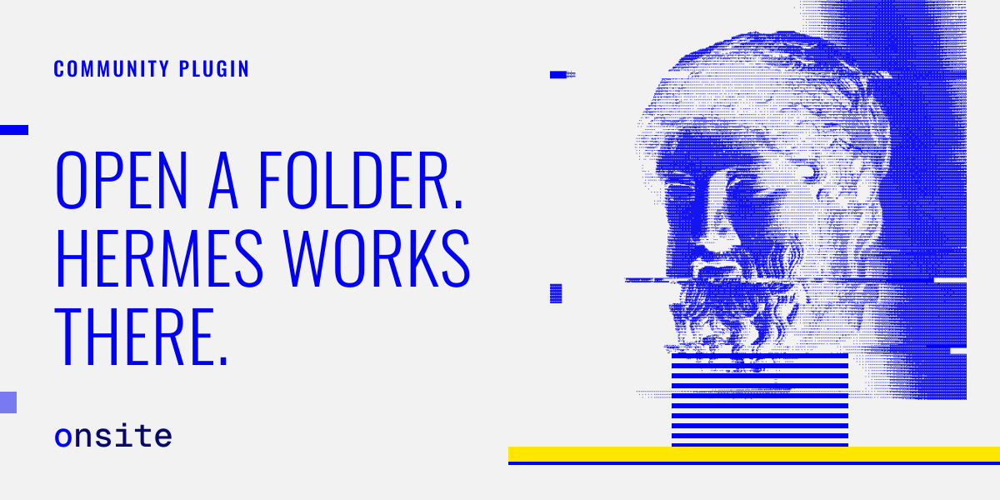

# onsite



Open a project folder on your own computer and the
[Hermes](https://github.com/NousResearch/hermes-agent) that lives on
your server works in it.

Hermes stays on your server. Its commands and file edits run on the
computer the folder lives on, as you. It is the way of working you
know from Claude Code, Codex and the other big coding apps, for a
Hermes that lives somewhere else.

- **Open a folder. That is the whole switch.** The folder you open
  picks the computer. There is no switch phrase and no mode.
- **Approve where you are.** Risky commands stop at Hermes' own
  prompt, in the app you are holding. A chip in the desktop app names
  the computer in use.
- **No program to run on your computer.** The server logs in to it
  over SSH, as you. Your computer needs its SSH server on and the
  server's key accepted. The server has to be able to reach it,
  directly or over a VPN.

It is a Hermes plugin. Hermes itself is not patched.

New to it? The [guide](docs/guide.md) shows each screen in plain
words.

**Status: v0.1.0, a first release candidate.** Phases 1 to 4 of the
build pass on a test rig, against a container and against a real
laptop. The last step, a person using it from the real clients, has
not happened. See [What is tested](#what-is-tested).

Site: <https://saxby-tools.github.io/hermes-onsite/>

## How it compares to the big coding apps

| What the big coding apps do | Hermes on a server, alone | With onsite |
| --- | --- | --- |
| Work in the project folder you open | Works on the server | Yes. The folder picks the computer |
| Run commands and edit files on your computer, as you | No | Yes |
| Ask before risky steps, in the app you are using | Yes, for the server | Yes, the same prompt |
| Show where the work is happening | No | A chip and a pane in the desktop app |
| Browse your computer's files and start work in a folder | No | Its real files, in the app's own folder picker and file tree. Not yet seen in the real app |
| Run a proposed command with one click | No | Run cards. Not yet seen in the real app |
| Use the tools on your computer | No | MCP servers run there |
| See and use your computer's screen | The server's screen only | Yes, by two routes. Narrowly tested |
| Offer a settings screen | No | A Machines page. Not yet seen in the real app |
| Work from a phone | Not checked | Not tested |

## How it works

<!-- onsite:diagram {"caption": "Chat goes to the host. Tool calls come back past the gate."} -->

```text
  the machine you sit at                    the always-on host
  ----------------------                    ------------------
  Hermes CLI, TUI, Desktop  --- chat --->   Hermes agent loop
  or an editor                              memory, skills, model
                                                   |
                                            approval gate (stock)
                                                   |
                                            onsite backend (this plugin)
                                              |              |
  your shell and files  <--- SSH, as you ---  laptop       mac
                                              target      target
                                                         (local)
```

<!-- /onsite:diagram -->

One backend plugin routes each session's tool calls to a named
target. The clients, the agent loop and the approval gate are stock
Hermes.

A session picks its target once, from the folder it was opened in:

1. A target set with `/onsite <target>` wins for that session.
2. Otherwise the longest matching path wins.
3. Otherwise the default target is used.

A session never moves to another machine by itself. If its target is
down, tool calls fail with an error that names the target.

<!-- onsite:notice {"kind": "terms"} -->

- **Host.** The server Hermes runs on. This page also calls it the
  server.
- **Target.** A computer Hermes' tools can run on: the host itself,
  or one it reaches over SSH. The desktop app calls it a machine.
- **Profile.** One Hermes set-up on the host, with its own settings
  and plugins. A host can hold several.
- **Gateway.** The Hermes service on the host that the apps talk to.
- **Agent plugin.** The part of onsite that runs on the host.
- **Desktop UI.** The part of onsite that runs inside the Hermes
  Desktop app, on the computer the app is on.
- **Folder rule.** Anything that ties a folder to a target: a
  prefix, a path map or a mount.
- **Mount.** A folder on the host that shows a target's whole disk,
  files and all. Nothing is copied.
- **Hermes home.** The folder that holds a profile's `config.yaml`.

<!-- /onsite:notice -->

In the examples the host's target is named `mac` and the other is
`laptop`. Both are only names.

## Requirements

- A server that runs Linux or macOS. Hermes also runs on Windows,
  but onsite has never been run on a Windows server and refuses to
  load on one. A target runs Linux or macOS too.
- Hermes v0.23.2. A later 0.23 release will load the plugin but has
  not been tried. Hermes 0.24 will not load it. A later release of
  onsite lifts that once it has been run there. `hermes --version`
  says what you have, and `hermes update --check` says what an
  update would bring. Hermes will offer the update. If you take it
  and `/onsite` is gone, that is why: set `terminal.backend` back to
  `local` until onsite catches up. See [Limits](#limits).
- `plugins.isolation: in_process`, which is Hermes' default.
  `hermes config get plugins.isolation` prints it. Hermes cannot run
  a terminal backend under the other setting.
- For an SSH target: the host must be able to log in to that machine
  with a key and no prompt, and the machine needs `bash`. So the
  machine runs an SSH server and has the host's public key in its
  `authorized_keys`. On a Mac the SSH server is one switch: System
  Settings, General, Sharing, Remote Login. On Linux it is the
  OpenSSH server, `sshd`. Its file transfer, SFTP, must be left on,
  as it is unless someone turned it off.

  Check it from the host, as the user Hermes runs as. This must
  return at once, with no question:

  ```bash
  ssh you@laptop.example true
  ```

  The first time, it asks whether to trust the machine's key. Say
  yes once. If it asks for a password, `ssh-copy-id
  you@laptop.example` on the host is the usual fix, after
  `ssh-keygen` if the host has no key yet. The host must be able to
  reach the machine: on the same network, or over a VPN.
- On a Linux server, the `sshfs` program, to show a target's files
  on the server. A macOS server needs nothing. See
  [A target's files on the host](#a-targets-files-on-the-host).
- No Python packages of its own. It drives the `ssh` program you
  already have and uses only what Hermes ships.

## Install

onsite has two parts. The agent plugin runs on the server. The
desktop UI runs in the Hermes Desktop app, on the computer the app is
on. A set-up that only uses a terminal needs the agent plugin alone.

A profile loads plugins only from its own folder. For any profile but
the default, write `hermes -p <profile>` in place of `hermes`, here
and in every command on this page.

### Option 1 (recommended): two installs, one on the server and one in the desktop app

1. On the server, run:

   ```bash
   hermes plugins install https://github.com/saxby-tools/hermes-onsite/tree/main/onsite --enable
   ```

2. In the desktop app, open Capabilities, then Plugins, and click
   "Install from Git".
3. Paste this address and click "Review repository":

   ```text
   https://github.com/saxby-tools/hermes-onsite/tree/main/onsite/desktop
   ```

4. Click Install.

It is done when a chip that starts with "onsite" shows at the bottom
right of the app.

### Option 2: one install, all from the desktop app

For a profile that does not have onsite yet.

1. In the desktop app, open Capabilities, then Plugins, and click
   "Install from Git".
2. Paste this address and click "Review repository":

   ```text
   https://github.com/saxby-tools/hermes-onsite/tree/main/onsite
   ```

3. The dialog lists two parts, "Agent plugin" and "Desktop UI".
   Under "Install for profile", pick the profile to install into.
4. Click Install. Both parts install and turn on.

### Troubleshooting

| What happens | What to do |
| --- | --- |
| The dialog says "No agent or desktop plugin artifacts found in this repository." | The address is missing its folder. Paste the whole address from the option, through `/onsite` or `/onsite/desktop`. |
| No chip after the install | Open Capabilities, then Plugins, open Onsite and turn on the switch labelled Desktop. |
| Onsite has no Desktop switch | The desktop UI is not on this computer. Run steps 2 to 4 of option 1 again. If the app is on the server itself, click Rescan, beside "Install from Git". |
| Option 2 says the agent plugin already exists | That profile has it. The desktop UI was still installed. Turn on its Desktop switch. Leave "Force reinstall" off, or it replaces the plugin on the server. |
| "Install from Git" cannot fetch the address | The computer needs `git`. Without it, copy the desktop UI by hand, below. |
| `hermes onsite` is not a command | The plugin is installed but off. Run `hermes plugins enable onsite`. |
| `/onsite` is unknown in a new chat | Restart the Hermes gateway. A running gateway should pick the plugin up without one. |
| Hermes warns about a custom, unreviewed source | Expected until onsite is in the Hermes catalog. |
| `hermes plugins list` says "provenance: drift" | Expected. Hermes says it of any plugin installed from a folder of a repository. |

#### Copy the desktop UI by hand

Run both lines on the server. They put one file on the computer the
app runs on:

```bash
ssh you@laptop.example mkdir -p .hermes/desktop-plugins/onsite
```

```bash
scp "$(dirname "$(hermes config path)")/plugins/onsite/desktop/plugin.js" you@laptop.example:.hermes/desktop-plugins/onsite/plugin.js
```

<!-- onsite:notice {"kind": "untested"} -->

The command in option 1 has been run into an empty Hermes home. The
two addresses have not yet been pasted into the real app. The copy
by hand is the only way the desktop UI has been installed so far.

<!-- /onsite:notice -->

### Update and remove

Neither has been tried with this plugin. Both are Hermes' own
commands, run on the server:

```bash
hermes plugins update onsite
```

To remove the plugin, hand the terminal back to Hermes first, so
that no session points at a backend that is gone:

```bash
hermes config set terminal.backend local
```

```bash
hermes plugins remove onsite
```

### To work on the plugin itself

Clone the repository on the server and link the one folder into a
profile:

```bash
git clone https://github.com/saxby-tools/hermes-onsite.git
```

```bash
mkdir -p "$(dirname "$(hermes config path)")/plugins"
```

```bash
ln -s "$PWD/hermes-onsite/onsite" "$(dirname "$(hermes config path)")/plugins/onsite"
```

```bash
hermes plugins enable onsite
```

## Set up

Five steps, all on the host. Step 1 can also be done in Hermes
Desktop: Settings, Plugins, Onsite, then Machines.

**1. Name your targets.** This is a dry run that prints the
settings:

```bash
hermes onsite init --ssh laptop=you@laptop.example --local mac
```

Add `--apply` to write them. With no flags, on a terminal, it asks
instead.

- `--ssh NAME=USER@HOST` names a machine the host reaches over SSH.
  `USER@HOST` is what you would type after `ssh` on the host. Add
  `:PORT` for a port other than 22. `--key NAME=FILE` and
  `--known-hosts NAME=FILE` name a key file and a known-hosts file
  for one target, when your SSH setup does not already.
- `--local NAME` names the host itself. With one such target, it is
  the default: the target used when no folder rule matches. With
  none or more than one, or to pick another, add `--default NAME`.
- It writes the whole list each time. A target left out is removed,
  and so is any setting it has no flag for, such as `screen`. Use
  it for the first set-up. After that, change one target in
  `config.yaml` or on the Machines page.

Two more flags say which folders belong to a target. Most set-ups
need neither, because the host mounts each target's disk and a
session opened there runs on that target. See
[A target's files on the host](#a-targets-files-on-the-host).

- `--prefix NAME=/PATH` is for a folder with the same path on the
  host and the target. A session opened under it runs on that
  target.
- `--map NAME=/HOST/PATH=/TARGET/PATH` is for a folder both machines
  share under different paths, such as a network mount.

**2. Select the backend.** It applies to sessions started after the
change:

```bash
hermes config set terminal.backend onsite
```

**3. Let the Run button work.** The agent can propose a command and
wait. `/run`, or the Run button in the desktop app, then asks it to
go ahead. Hermes keeps a plugin from putting a message into a chat
until you allow it. Without this, Run is greyed out in the app, and
`/run` in the app and the TUI only tells you to ask the agent
yourself:

```bash
hermes config set plugins.entries.onsite.allow_gateway_injection true
```

**4. Check it.**

```bash
hermes onsite status
```

The list at the end should read `up` for each target, and `*` marks
the default. The lines above it say where a session started in the
folder you are standing in would run, and why. `DOWN` is followed by
SSH's own reason. Fix that first: the `ssh` check under
[Requirements](#requirements) must pass. If step 2 was missed, the
first line says onsite is set up but not in use.

**5. Try it.** The laptop must read `up` in step 4. Open a folder
that is on the laptop. Use one that exists there:

```bash
hermes onsite open laptop:~/work/site
```

It mounts the laptop's disk on the host and prints where that folder
is. Go to the folder, start `hermes` there and ask it to run
`uname -n`. It prints the laptop's name, and `/onsite` says
`laptop`. If it prints the host's name, the session was started
before step 2, or in another folder. On a Linux host the command may
say that `sshfs` is missing, with the line that installs it. In
Hermes Desktop the pane does the same with a click. The
[guide](docs/guide.md) shows it.

After the first four steps, `config.yaml` holds these keys. The
order may differ, and Hermes keeps others of its own beside them:

```yaml
terminal:
  backend: onsite

plugins:
  enabled:
    - onsite
  entries:
    onsite:
      allow_gateway_injection: true
      settings:
        default: mac
        targets:
          laptop:
            kind: ssh
            user: you
            host: laptop.example
          mac:
            kind: local
```

### Target settings

| Key | For | Meaning |
| --- | --- | --- |
| `kind` | all | `ssh` or `local`. |
| `host`, `user` | ssh | Where to log in, and as whom. |
| `port` | ssh | Default 22. |
| `key` | ssh | A private key file. Default: your SSH setup decides. |
| `known_hosts` | ssh | A known-hosts file for this target alone. |
| `prefixes` | all | Sessions opened under these folders go to this target. |
| `path_map` | all | A folder on the host, and the same folder on the target. |
| `path` | ssh | `interactive` (default) or `none`. See below. |
| `inhibit_sleep` | ssh | Default true. See below. |
| `connect_timeout` | ssh | Seconds. Default 3. |
| `mount` | ssh | The folder on the host where the target's disk is mounted. Default: `~/.local/share/onsite/mount/<profile>/<name>` in the home folder of the account Hermes runs as. |
| `start` | ssh | The folder on the target a new session opens in. A full path. Default: the folder a login there lands in, your home folder. |
| `screen` | ssh | How its screen is reached: `auto` (default), `driver` or `sharing`. See [Screen control](#screen-control-on-a-target). |
| `screen_port` | ssh | The port its screen sharing listens on. Default 5900. |

**`path_map`** is for when the two machines name one folder
differently. A host that mounts your laptop's `~/Development` at
`/Users/you/Development` needs a map. It both routes the session and
translates the folder. `hermes onsite init` writes one with
`--map laptop=/Users/you/Development=/home/you/Development`:

```yaml
laptop:
  kind: ssh
  user: you
  host: laptop.example
  path_map:
    /Users/you/Development: /home/you/Development
```

**`path: interactive`** reads PATH once per connection from an
interactive shell on the target. A plain SSH shell skips
`.zshrc` and `.bashrc`, where many people build PATH, so tools such
as `node` would otherwise be missing.

**`inhibit_sleep`** holds a sleep inhibitor on the target while a
command runs. It uses `systemd-inhibit` or `caffeinate` when the
target has one and allows it. It is never held between commands.

On a `systemd` laptop, expect less than the name promises. An SSH
login is refused a blocking lock and gets a delay lock, which holds
sleep off for five seconds by default (`InhibitDelayMaxSec` in
`logind.conf`). That covers a short write. A long one can still be
cut by a closing lid.

### A target's files on the host

Hermes only runs a session in a folder the host can see, and the
desktop app's folder picker and file tree read the host's disk. So
the host mounts each SSH target's whole disk in a folder of its own.
You see the target's real files there. Nothing is copied, and a file
saved there is saved on the target.

Open a session in a folder under the mount and it runs in the real
folder on the target. There is no set-up. In Hermes Desktop, click
"New session" beside a machine in the pane. From a terminal:

```bash
hermes onsite open laptop:~/work/site
```

It prints where that folder is on the host. Start `hermes` there.
With a name alone, `hermes onsite open laptop`, it is the target's
start folder.

**Where it is mounted.** On the host, at
`~/.local/share/onsite/mount/<profile>/<target>`. That is the
standard folder for a program's own data, in the home folder of the
account Hermes runs as. Nothing is added to the top of that home
folder. `<profile>` is the name of the profile's folder, and
`hermes` for the default one. The target's root is the top of the
mount, so `/home/you/work` on the laptop is
`.../mount/<profile>/laptop/home/you/work` on the host. To mount it
somewhere else, add
`--mount laptop=/Users/you/Mounts/laptop` to the `init` command, or
set `mount` in the target's settings. On a macOS host the folder
above it, here `Mounts`, must be one that only your account can
open. The plugin makes it that way when it is not there yet. It
never changes a folder that is.

The mounts are kept out of the Hermes home on purpose. Deleting a
profile deletes everything under its folder, and that would reach
through a mount into the target's own files. For the same reason,
do not name a mount place in a folder that gets emptied, such as a
cache or a temporary folder, or inside a git repository. Take a
mount down with `hermes onsite mount --stop` before you delete the
folder it is in.

**Where a new session starts.** In the folder a login on the target
lands in, which is your home folder there. The plugin asks the
target for it. To start somewhere else, add
`--start laptop=/home/you/work` to the `init` command, or set
`start` in the target's settings.

**When it is mounted.** The first time something asks: the pane
opening, `hermes onsite open`, or the chip's check for a session
that is already in a mounted folder. It then stays until the host
restarts, and comes back the same way. To mount every SSH target, or
one, by hand:

```bash
hermes onsite mount
```

```bash
hermes onsite mount laptop
```

To take one down. Nothing on the target changes:

```bash
hermes onsite mount laptop --stop
```

**What the host needs.** It depends on the host's system.

- **macOS: nothing.** macOS can mount a network disk for a normal
  user. The plugin runs a small file server for it, a helper process
  per target that listens only on the host's own loopback address,
  and reads the target's files over SSH's file transfer, SFTP.
- **Linux: `sshfs`.** Linux has no such door without root, so the
  host needs the `sshfs` program. When it is missing, the error
  names the line to run for your distribution. The plugin never runs
  it for you:

  | Distribution | Run on the host |
  | --- | --- |
  | Debian, Ubuntu | `sudo apt install sshfs` |
  | Fedora, RHEL, CentOS | `sudo dnf install fuse-sshfs` |
  | Arch | `sudo pacman -S sshfs` |
  | Alpine | `sudo apk add sshfs` |
  | openSUSE | `sudo zypper install sshfs` |
  | NixOS | `nix-env -iA nixos.sshfs` |

**When the target is away.** The mount stays, and reading it fails
within a few seconds, not forever. It works again by itself a few
seconds after the target is back.

<!-- onsite:notice {"kind": "untested"} -->

The macOS route runs on one real host against one real Linux laptop.
The Linux route has run in a container only, never on a real Linux
server. Nobody has yet used either from the real desktop app.

<!-- /onsite:notice -->

### MCP servers on a target

An MCP server can run on a target, so its tools act there. Hermes
starts a local MCP server by running a command, and that command can
be `ssh`. This shows the call. To add the server, put `--apply`
before the `--`:

```bash
hermes onsite mcp laptop files -- npx -y @modelcontextprotocol/server-filesystem /home/you
```

The server is named for its target, here `laptop_files`, and Hermes
lists its tools as `mcp__laptop_files__...`. To Hermes it is an
ordinary MCP server, so its own approval prompts apply. No tool call
is rerouted.

Hermes loads MCP servers for a whole profile, so every session sees
these tools. The plugin refuses one in a session that runs on another
machine, and tells the agent to say so. A session never acts on a
second machine by itself.

### Screen control on a target

Hermes' `computer_use` tool can act on a target's screen. It follows
the session: a session on the host keeps the host's screen, and a
session on a target gets that target's.

There are two ways to a target's screen.

| Route | Needs on the target | What Hermes gets |
| --- | --- | --- |
| Hermes' driver | Hermes' own screen driver, installed by you | Windows and buttons by name, and a check that a click landed |
| Screen sharing | The screen sharing the machine already has | Pixels only. Hermes clicks by position and looks again to see what happened |

A target is left on `screen: auto`. It uses the driver when the
target has one, and screen sharing when not. Set `screen: driver` or
`screen: sharing` to choose. The plugin never installs anything on a
target. This checks a target, names the route it would use and says
what is missing:

```bash
hermes onsite screen laptop
```

**Hermes' driver.** The driver is a program named `cua-driver`. It
runs on the target and talks to Hermes over the SSH link. You
install it there yourself. If the target has a Hermes of its own,
`hermes computer-use install` on the target does it. If not, install
`cua-driver` the way its own project describes.

**Screen sharing.** Turn on the target's screen sharing so that it
listens only on the target itself, at `127.0.0.1`. The plugin reaches
it through SSH, so nothing is opened in a firewall and SSH stays the
lock. The target's SSH server has to allow forwarding, which it does
unless someone turned it off. Screen sharing here means VNC:

- On Linux with X11, `x11vnc -localhost -nopw -forever -shared`
  shares the desktop you are logged in to.
- On a Mac, turn on Screen Sharing, then "VNC viewers may control
  screen with password" in its settings. A Mac always asks for that
  password. How to keep a Mac's Screen Sharing to `127.0.0.1` alone
  has not been worked out here.
- GNOME's own sharing on Wayland speaks RDP, not VNC. It is not
  covered.

A VNC password never goes in the settings. Put it in the profile's
`.env` file, under the one name the plugin declares. `hermes config
env-path` prints where that file is:

```text
ONSITE_SCREEN_PASSWORD=...
```

Hermes hands it to the plugin for that profile only. It is used for
any target whose screen sharing asks for a password, so targets that
need different passwords are not covered yet. To pin a target to
screen sharing:

```yaml
laptop:
  kind: ssh
  host: laptop.example
  user: you
  screen: sharing
```

**Turn it on.** Link the screen backend into place and select it.
The first command is a dry run. Add `--apply` to make the link:

```bash
hermes onsite screen-install
```

```bash
hermes config set computer_use.backend onsite-screen
```

Hermes' own approval prompt and hard blocks still stand in front of
every click and keystroke, on both routes. The prompt does not name
the machine, so check the status chip or `/onsite` when it matters.
Over screen sharing, the key combinations Hermes hard-blocks are
checked a second time by the plugin, because several key names are
one key there.

This is new and narrowly tested. The driver has run on a Linux X11
desktop in the test rig, with Hermes' pinned version. Screen sharing
has run against `x11vnc` in the same rig, with and without a
password. Neither has been tried on a Mac. See
[What is tested](#what-is-tested).

## Use

| What | CLI and TUI | Hermes Desktop |
| --- | --- | --- |
| See where tools run | `/onsite`, or `hermes onsite status` | A chip on the right of the status bar. |
| Move this session | `/onsite <target>`, back with `/onsite auto`. The agent is told with your next message. | Same, typed in the chat. |
| Approve a risky command | Hermes' own prompt | Hermes' own prompt. |
| Run a command the agent proposed | `/run <number>` | Run and Copy buttons, in a pane and in the transcript. |
| Open a folder on a machine | `hermes onsite open laptop:~/work`, then start `hermes` in the folder it prints | "New session" beside the machine in the pane. The app's own folder picker then opens on its files. |
| Add or change a machine | Edit `config.yaml`. `hermes onsite init` is for the first set-up: it rewrites the whole list | Settings, Plugins, Onsite, then Machines. |
| Test a machine | `hermes onsite status` | "Test connection" in the machine's form. |

The agent has a tool, `propose_command`. It saves a command with a
number and runs nothing. `/run N` then asks the agent to run it with
the terminal tool, so the approval prompt still applies.

## When a target is down

- A tool call returns an error that names the target, within about
  three seconds. No command is sent. The chip's own check allows one
  second more, so its hover text reads "no answer in 4s".
- Later calls fail at once for ten seconds, then one call checks
  again. Service resumes by itself when the target is back.
- A link lost while a command is running is reported as "no exit
  status". The command may have run. It is never retried, because a
  retry could repeat a write.

The agent is told the same thing in plain words, and told not to work
around it.

## What it touches

Read this before you install it. It is the full list, as far as the
code has been read for it.

**On a target.** It runs shell commands and reads and writes files
there, as the account you named, with everything that account may do.
The commands and edits are the ones the agent asks for. Hermes'
approval prompt is the only gate.

The plugin also runs a few commands of its own there. Each time a
session's environment is built, and each time an MCP server starts
there, it starts your interactive shell once to read PATH. It also
tries the sleep lock then. Hermes rebuilds an environment that has
sat unused for a few minutes. While a command runs it may hold that lock
(`systemd-inhibit` or `caffeinate`). To see whether a target is up it
logs in and runs `true`. To check a screen it reads the environment
of your own desktop processes and asks its screen sharing to answer.

For the mount, it keeps one link open to the target's SFTP server,
the file transfer its SSH server already has. Through it, anything
on the host that reads or writes under the mount reads or writes the
target's real files, as your account there: the desktop app's file
tree and folder picker, Hermes, and any program you point at that
folder. On a macOS host it refuses to write the files macOS leaves
on every disk it looks at, such as `.DS_Store` and names that start
with `._`.

With screen control on, it starts Hermes' screen driver there, or
connects to the screen sharing the target already runs. Either can
see the screen and send clicks and keys.

It installs nothing on a target. It does not copy Hermes'
credentials, skills or cache there, which Hermes' own SSH backend
does. Hermes' SSH code, which the plugin reuses, writes one small
file to the target's `/tmp` each time it builds a session's
environment, named `hermes-snap-` and an id. It holds your shell's
exported variables, functions and aliases, and only your account can
read it. Hermes leaves these files behind. The plugin removes each
one when its environment is closed. If Hermes is stopped without
closing it, or the target is down at that moment, the file stays
until the target's temp folder is next cleared.

**On the host.** It starts `ssh` processes: one kept open per target
while sessions use it, one per mounted target, one for each MCP
server you add, and one per session that uses a target's screen.
Short ones come and go: a check that a target is up, a screen check.

It mounts each SSH target's disk in a folder on the host. On macOS
that is a helper process per target, `mountd.py` from the plugin's
own folder, which keeps running after the command that started it.
The helper is a file server that listens on `127.0.0.1` only, on a
port the system picks. It hands the disk out once, to the host's own
`mount_nfs`, under a name made of random characters. It answers
whoever can reach the mount as your account on the target, so the
folder that holds the mounts is closed to every account but yours,
and a mount place that others can reach is refused. On Linux it
runs `sshfs` instead, which is its own process. Either stays until
`hermes onsite mount --stop` or a restart of the host. With Hermes
Desktop open and in view, the chip asks for the state every five
seconds and after each tool call. Each time, the plugin logs in to
the session's target to see that it is up. While the pane is open it
logs in to every SSH target, to draw the list.

It files each target's host key on first contact: in your
`known_hosts`, or in the file a target's `known_hosts` setting
names. It writes three small files under `plugin-data/onsite/` in
the profile's Hermes home: which target each session is pinned to,
each session's folder, and the commands the agent has proposed. One
small state file per mount is there too, in `mount-state/`. The
mounts themselves are in `~/.local/share/onsite/mount/`, or where
you name.
`hermes onsite screen-install
--apply` makes one link, `plugins/onsite-screen`, in the profile's
Hermes home. `hermes onsite mcp --apply` adds an MCP server to the
profile with Hermes' own `hermes mcp add`.

**Your keys.** It uses the `ssh` program and whatever keys your SSH
setup offers. It never reads, copies or stores a key. A VNC password,
when a target's screen sharing asks for one, is `ONSITE_SCREEN_PASSWORD`
from the profile's own secrets. The plugin asks Hermes for it each
time a link opens and never writes it down.

**The network.** It opens SSH connections to the targets you name.
The macOS file server is reachable from the host itself and from
nowhere else. It sends no telemetry and calls no other service.
It does not update itself.

**Inside Hermes.** It registers a terminal backend, one tool
(`propose_command`), two hooks, two slash commands, one CLI command
and one section of the system prompt. The section tells the agent
which machine the session runs on. One hook runs before each tool
call. It can refuse an MCP tool that belongs to another machine; it
never approves anything. The other runs before each turn. After
`/onsite` moves a session, it adds one note to your next message
that tells the agent which machine its tools now run on. `/run` puts
a message into the chat for the agent. In the TUI and the desktop
app that needs `allow_gateway_injection: true`. It serves seven
routes to the desktop app under `/api/plugins/onsite/`. Two of them
write the plugin's own settings and one mounts a target's disk. The
desktop half adds a status chip, a pane, a run card and two settings
pages. Once linked and selected, the screen backend is one more
thing Hermes loads.

**Private Hermes code.** It imports Hermes modules that are not
plugin API, to reuse Hermes' own SSH, local and screen code. They are
listed in `onsite/compat.py` and `onsite/screenbackend.py`. A Hermes
release can
move them, which is why `requires_hermes` has an upper bound.

## Limits

Read these before trusting it with real work.

- **No sandbox.** An SSH target can do anything its user can.
  Hermes' approval prompts are the only gate. Keep them on.
- **Private Hermes APIs.** The plugin reuses Hermes' own local, SSH
  and screen-driver code, which is not public plugin API. Those
  imports are in `compat.py` and `screenbackend.py`. It has been run
  on Hermes 0.23.2 only, and `requires_hermes` stops it loading at
  0.24.
- **Editors over ACP.** Hermes previews an edit by reading the file
  on the host. In an editor such as Zed, `patch` only works where the
  same path exists on both machines, as in a shared folder.
  `write_file` and the terminal work everywhere.
- **The folder must exist on the host.** Hermes will not run a turn
  in a folder the host cannot see, and the desktop app's folder
  picker and file tree read the host's disk. So the plugin mounts
  each SSH target's disk on the host. A host that cannot mount, such
  as a Linux server without `sshfs`, gets an error with the fix and
  no second way in.
- **A mount is a network disk.** Each file read crosses the network.
  On one home network a save took about 0.2 seconds, and so did
  `git status` in one repository. A program on the host that
  walks a big folder through the mount will be slow. Hermes' own
  commands do not go through it. They run on the target.
- **No file locks through the mount.** Two programs that lock one
  file, one on the host and one on the target, do not see each
  other's lock.
- **A sleeping target stops the work.** Reads through its mount fail
  in a few seconds and tool calls say the target is down. That is
  meant. Nothing moves to another machine.
- **Linux and macOS servers only.** The plugin refuses to load on a
  Windows server. On a Linux server the mount has run in a container
  and nowhere else.
- **The Bots tab in Hermes Desktop.** The app sends the chip's
  requests to its active profile, which is set in the Sessions tab.
  With a bot's chat open in the Bots tab, the chip can describe a
  different profile. It names the one it asked.
- **Before the first message,** `/onsite` cannot know a session's
  folder and says so.
- **Screen sharing sees pixels.** On that route Hermes cannot name a
  button, list windows or check that a click did what was meant. It
  clicks by position and looks again. The driver route is the better
  one where you can install it.
- **A VNC password is weak.** It is cut to eight characters and
  protected by a cipher broken long ago. That is the protocol, not
  the plugin. Keep screen sharing on the target's loopback address,
  where only SSH can reach it.
- **One slow case.** A target that freezes in the few seconds before
  a call can take about seven seconds to report, not three.
- **Host-only guards.** Hermes guards keyed on the backend name
  `local`, such as the self-repo guard, do not run for a `local`
  target here.
- **Lost on SSH targets.** LSP diagnostics and host-side search
  speedups. `/rollback` checkpoints run on the host and do not cover
  a remote target.

[DECISIONS.md](DECISIONS.md) has the reason for each.

## What is tested

| Phase | What | Checks | Result |
| --- | --- | --- | --- |
| 1 | Routing, file tools, approvals | 18 | Pass |
| 2 | A stopped, a frozen and a returning target | 20 | Pass |
| 3 | `/onsite`, `/run`, `hermes onsite status` and `init`, CLI and TUI | 31 | Pass |
| 4 | Routes for status, machines and a mounted disk; desktop plugin logic | 17 | Pass |
| Share | A target's screen through screen sharing, with no Hermes session: link, pixels, typing, a drag, each button | 8 | Pass |
| Screen | A target's screen through a Hermes session and its approval prompt: look, deny, approve | 8 | Last passed on Nov. 23, before screen sharing was added. Not run since: see below |
| 5 | A person at the real clients | 0 | Not run |

Phases 1 to 4 pass twice: against a container on the host, 86
checks, and against a real Linux laptop over a real network. The
laptop run adds three checks of the sleep lock, for 89 in all. The
two screen phases run on a container with its own desktop. The output
of each run is in [rig/results/](rig/results/). The laptop's files
start with `real-`.

The screen phase goes through the Hermes gateway. It passed with
Hermes' driver before the plugin moved into its own folder. The
gateway on the build machine has run since before that move and holds
an old copy of the screen backend, so the phase cannot pass there
until that gateway is restarted, which this build does not do. In
its place, both routes were run inside a fresh Hermes process against
the same desktop, through Hermes' own tool code: a capture, a click,
a typed line and a key each landed. The screen phase has never run
over screen sharing. It has ten checks now. The two added since its
last pass look for the screen-sharing and route lines of
`hermes onsite screen`.

One real-model command has also run from the host's copy of a shared
folder and landed on the laptop, as the laptop's user.

Hermes' own check, `hermes plugins validate`, passes on a copy
installed from GitHub. It warns that the plugin imports private
Hermes modules, which [Limits](#limits) covers.

<!-- onsite:notice {"kind": "untested"} -->

Not yet tested by anyone:

- A laptop that really sleeps or drops off the network. The rig
  fakes both by cutting a relay in front of the laptop's SSH port.
- A person approving a real command in the TUI, the desktop app and
  an editor.
- The run card, the "New session" button and the Machines page
  inside the real Hermes Desktop app, and the app's own folder
  picker and file tree on a mounted disk. The chip and the pane have been
  seen there, on a gateway that serves several profiles, with the
  laptop shown as connected.
- A macOS machine as an SSH target, and `caffeinate`.
- `hermes plugins install` into a profile that a live gateway
  serves, and the desktop app's "Install from Git". The command
  itself has run into an empty Hermes home, where set-up then
  worked.
- Screen control on macOS, on Wayland, or on any desktop a
  person is using. It has run only against the rig's own X11
  desktop.
- Screen sharing against any server but `x11vnc`, on a Mac, or
  through a Hermes session's approval prompt.
- An MCP server on a target, beyond one test server run by hand on
  the laptop.

<!-- /onsite:notice -->

### Run the tests

Unit tests need `pytest`. Six of them also need the two packages
Hermes ships for pictures and ciphers, and are skipped without them:

```bash
uv run --no-project --with pytest --with pillow --with cryptography python -m pytest
```

The desktop tests borrow React and jsdom from a Hermes checkout:

```bash
node --test tests/desktop.test.mjs
```

The rig needs Docker and a Hermes test profile. It is a dry run
unless `--apply` is given:

```bash
python3 rig/run.py
```

```bash
python3 rig/run.py --apply
```

To test against a real machine, name it. It must take your SSH
key with no prompt. The rig writes only under
`~/.cache/onsite-rig` there and removes it at the end:

```bash
python3 rig/run.py --apply --real you@laptop.example
```

Screen control is tested on a container with a desktop nobody looks
at, Hermes' own screen driver and a VNC server. Its results start
with `desk-`. The `screen` phase goes through a Hermes session and
its approval prompt. Add `--share` to run it over screen sharing:

```bash
python3 rig/run.py --apply --desk --phase screen
```

```bash
python3 rig/run.py --apply --desk --share --phase screen
```

The `share` phase drives the same desktop with the plugin's own
code and no Hermes session, so it needs no running gateway:

```bash
python3 rig/run.py --apply --desk --phase share
```

It swaps the test profile's `config.yaml` for the run and puts it
back at the end. It never restarts the Hermes gateway.

## Layout

```text
onsite/              the plugin: all that an install puts on a host
  plugin.yaml        the manifest
  __init__.py        register(ctx)
  compat.py          what the terminal side imports from Hermes
  config.py          parse and validate the settings
  routing.py         pick a target from a folder
  runtime.py         shared state: pins, breakers, status, settings
  provider.py        the `onsite` terminal backend
  targets/           one class per kind of target: ssh, local
  health.py          probe and circuit breaker
  remote.py          SSH options, PATH, sleep inhibitor
  paths.py           tell a host folder from a target folder
  link.py            one ssh process, read and written as a pipe
  oneshot.py         run one short script on a target
  sftp.py            an SFTP client over the ssh program
  remotefs.py        a target's files, with a short memory
  nfsd.py            a small NFS server for a macOS host
  mounts.py          mount a target's disk on the host
  mountd.py          the helper process that serves one mount
  mcptools.py        MCP servers that run on a target
  screen.py          find a target's desktop, and pick a route to it
  screenbackend.py   Hermes' screen driver, run on a target
  rfb.py             the screen-sharing (VNC) protocol
  screenshare.py     clicks, keys and pictures over screen sharing
  sharebackend.py    Hermes' screen tool, through screen sharing
  onsite-screen/     the folder Hermes finds the screen backend by
  exits.py           the four ways a command can end
  hooks.py           file tools on the right folder, MCP tools on
                     the right machine, a note after a move
  moves.py           a session's move, held until its agent is told
  pins.py            the target each session is pinned to
  proposals.py       the commands the agent has proposed
  store.py           the small files those two are kept in
  commands.py        /onsite, /run, hermes onsite
  tools.py           propose_command
  prompt.py          the per-session note in the system prompt
  messages.py        most of the text shown to a person or the model
  wizard.py          hermes onsite init
  api.py             what the desktop half is told and may change
  dashboard/         the HTTP routes Hermes mounts
  desktop/plugin.js  chip, pane, run card, new session, Machines
tests/               unit tests
rig/                 the end-to-end rig and its saved results
docs/                the design page, brand files, QA journeys, drafts
site/                the site's build: Eleventy, layouts, styles
```

## License

Copyright (C) 2026 saxby-tools.

onsite is free software. You can redistribute it and modify it
under the terms of the GNU Affero General Public License as published
by the Free Software Foundation, either version 3 of the License, or
(at your option) any later version. See [LICENSE](LICENSE).

It comes with no warranty.

In short: you may use, study, change and share it. If you share a
changed copy, or run one as a service for other people, you must
offer them its source under the same license. Hermes itself is MIT
licensed, which allows a plugin under these terms.

Built by Claude Code from a brief. Every commit after the first
says so.
