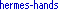
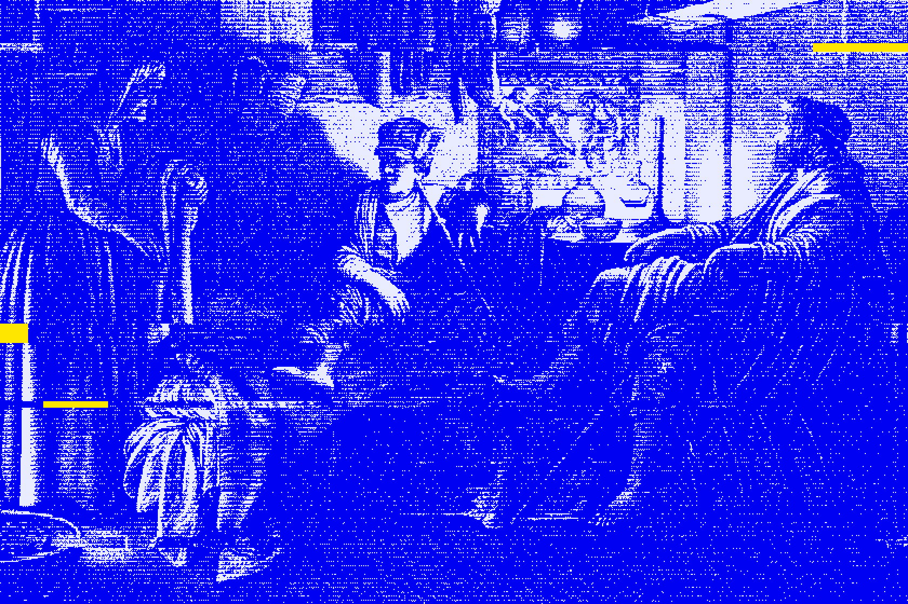

# Design system

The look has a name: glitched marble. It borrows the electric blue
and the condensed type of the Hermes site, and screens classical art
into that blue. The mark, the yellow and the plates are this
project's own.

This page is the reference and the test page. On the site, every
token and component below is drawn live from the stylesheet, so a
change that breaks one shows here first. On GitHub it reads as plain
tables.

onsite is a community plugin. Nothing here uses the Hermes wing or
any Nous Research mark, and no page may call itself official.

## Brand

The mark is called "On, lit". It is the letters o and n in Geist Mono
on a blue tile, with the o lit in yellow. On, as in switched on, and
as in on your computer.

The wordmark is the word onsite in the same face, with the o lit.
This site's masthead shows the wordmark. Its footer shows the mark.

<!-- onsite:marks -->

| File | Ground | Use |
| --- | --- | --- |
|  | any | Tab icon, avatar, anywhere the ground is unknown |
|  | light | One colour, on light pages and in print |
|  | blue | One colour, on blue and dark grounds |
|  | blue | The name, with the o lit in yellow |
|  | light | The name, with the o lit in blue |
|  | light | The name, one colour |
|  | blue | The name, one colour |

<!-- /onsite:marks -->

| Piece | Ground | The o | The rest |
| --- | --- | --- | --- |
| The mark | Its own blue tile, on any ground | `--color-signal` | `--color-field-text` |
| The wordmark | The blue field, or a dark page | `--color-signal` | `--color-field-text` |
| The wordmark | Pale grounds | `--color-field` | `--color-signal-text` |
| Either, in one colour | Any | Not lit | One colour |

Rules for the mark and the wordmark:

- Never show the mark smaller than 16 pixels.
- Keep clear space around the mark equal to a quarter of its width.
- The yellow is only for the lit o. Never light another letter.
- On pale grounds yellow cannot be read, so the o is blue there.
- Do not set the mark beside the wordmark. Together they say "on"
  twice. The mark goes where a square is needed, such as a tab icon.
  The wordmark goes where a name is needed.
- Do not redraw, tilt, outline or recolour either one.

On this site both are set in type, at weight 500 of Geist Mono. The
files above hold the same letters as outlines, so they need no font
installed. `brand/make-brand.py` draws them from the font files, and
fails if its numbers and the stylesheet's drift apart.
`brand/make-icons.sh` turns the mark into the site's icons.

### Plates

Two public-domain pictures, each screened into blue as broken lines
with a few rows knocked sideways.

Plate I is the hero. It is an engraving of 1613 by Hendrik Goudt,
after a painting by Adam Elsheimer, from the Cleveland Museum of Art.
It shows a story the Roman poet Ovid tells. Jupiter and Mercury, who
is Hermes, travel as strangers and are turned away at every door in
a town. One old couple, Philemon and Baucis, takes them in. Mercury
is the young man in the winged hat. `brand/make-plate-table.sh` makes
the plate.

Plate II is a Roman marble head from a herm, from The Metropolitan
Museum of Art. A herm was a pillar that carried the head of Hermes
and stood at the door of a house. `brand/make-plates.sh` makes it.

| Plate I, at your table | Plate II, at your door |
| --- | --- |
|  |  |

Both say the same thing as the name: the gods came to where you
were. A third plate, a marble hand, was retired with the old name.

## Colour

Every text pair below passes WCAG AA. The lowest is the red chip, at
5.5 to 1.

<!-- onsite:swatches -->

| Token | Light | Dark | Used for |
| --- | --- | --- | --- |
| `--color-ground` | `#f2f2f2` | `#05053d` | The page |
| `--color-ground-raised` | `#e4e5f6` | `#0c0c58` | Callouts, the status box, inline code |
| `--color-text` | `#06066b` | `#f2f2f2` | Body text. 15.1 to 1 on light, 17.1 on dark |
| `--color-text-muted` | `#3a3a9c` | `#aab2ff` | Captions and small notes. 8.3 and 9.6 to 1 |
| `--color-link` | `#0000f2` | `#aab2ff` | Links and focus rings. 8.2 and 9.6 to 1 |
| `--color-line` | `#c9c9dc` | `#2a2a86` | Rules and table lines |
| `--color-field` | `#0000f2` | `#0000f2` | The masthead, the hero, the footer, the diagram |
| `--color-field-deep` | `#0000c2` | `#0000c2` | Boxes on the blue field |
| `--color-field-text` | `#f2f2f2` | `#f2f2f2` | Text on the blue field. 8.2 to 1 |
| `--color-field-muted` | `#c9ceff` | `#c9ceff` | Quiet text on the blue field. 6.0 to 1 |
| `--color-code` | `#00003a` | `#00003a` | Code blocks |
| `--color-code-text` | `#f2f2f2` | `#f2f2f2` | Code. 17.7 to 1 |
| `--color-code-muted` | `#aab2ff` | `#aab2ff` | Code block labels |
| `--color-pass` | `#0000c2` | `#c9ceff` | The "Pass" chip |
| `--color-pass-text` | `#f2f2f2` | `#06066b` | Text on the "Pass" chip |
| `--color-signal` | `#ffe600` | `#ffe600` | Anything not yet proven; the lit o of the mark |
| `--color-signal-text` | `#06066b` | `#06066b` | Text on yellow. 13.3 to 1 |
| `--color-stop` | `#ff5a4d` | `#ff5a4d` | Hard limits |
| `--color-stop-text` | `#06066b` | `#06066b` | Text on red. 5.5 to 1 |

<!-- /onsite:swatches -->

The blue field is the same in both themes. The dark theme changes the
page around it from paper to navy.

## Type

<!-- onsite:specimen -->

| Class | Sample |
| --- | --- |
| `type-display` | One agent, two machines |
| `type-title` | How a tool call travels |
| `type-heading` | When a target is down |
| `type-label` | Install · Use · Limits · Tested |
| `type-body` | A session picks its target once, from the folder it was opened in. |
| `type-small` | The output of each run is saved with the rig. |
| `type-mono` | hermes config set terminal.backend onsite |
| `type-plate` | Plate I. Jupiter and Mercury at the house of Philemon and Baucis. |

<!-- /onsite:specimen -->

| Token | Face | Cost |
| --- | --- | --- |
| `--font-display` | Oswald, weights 200 to 700 | 28 KB, self-hosted |
| `--font-mono` | Geist Mono, weights 400 and 500 | 20 KB, self-hosted |
| `--font-body` | The system's sans | Nothing |
| `--font-plate` | The system's serif, in italic | Nothing |

Both self-hosted faces are under the SIL Open Font License. Their
license texts sit beside them in `site/static/fonts/`.

| Token | Value |
| --- | --- |
| `--size-label` | 0.75rem |
| `--size-small` | 0.875rem |
| `--size-body` | 1.0625rem |
| `--size-heading` | 1.5rem |
| `--size-title` | 2rem to 3rem, with the window |
| `--size-display` | 2.5rem to 4.75rem, with the window |
| `--track` | 0.1em, for capitals |

## Space

<!-- onsite:scale -->

| Token | Value |
| --- | --- |
| `--space-1` | 0.25rem |
| `--space-2` | 0.5rem |
| `--space-3` | 1rem |
| `--space-4` | 1.5rem |
| `--space-5` | 2.5rem |
| `--space-6` | 4rem |

<!-- /onsite:scale -->

The gutter is `--gutter`, 1rem, on every screen. Text keeps to
`--measure`, 42rem. The page column is `--column`, 70rem. The
masthead is `--top-height`, 3.5rem, tall. The "On this page" bar
under it is `--contents-height`, 2.75rem, tall.

## Radius

Boxes are square. Only controls are eased, and only a little.

| Token | Value | Used for |
| --- | --- | --- |
| `--radius-box` | 0 | Every box, chip and plate |
| `--radius-control` | 0.125rem | Buttons and focus rings |

## Motion

Motion is small and quick, and it stops for readers who ask their
system for less of it.

| Token | Value | Used for |
| --- | --- | --- |
| `--motion-fast` | 120ms | Hover and press |
| `--motion-slow` | 320ms | Larger moves |
| `--motion-ease` | cubic-bezier(0.2, 0, 0, 1) | Every move |

<!-- onsite:motion /-->

## Components

The masthead and the footer are on this page. The hero is on the
[front page](../README.md).

### Theme toggle

Three choices in one box, in the masthead: System, Light and Dark.
System follows the reader's device and is the default. Light and Dark
are remembered. It is boxed so that it reads as a control, not as one
more link.

### Status box

A paragraph that opens with a bold "Status:" is boxed.

**Status: an example.** This is how the status line of the README
looks on the site.

### Chips

<!-- onsite:chips -->

- Pass
- Not run
- Not tested
- Limit
- v0.1.0

<!-- /onsite:chips -->

In a table, a cell that says only "Pass" or "Not run" becomes a chip.

### Table

| Phase | What | Result |
| --- | --- | --- |
| 1 | Routing, file tools, approvals | Pass |
| 5 | A person at the real clients | Not run |

### Code block

Shell and YAML blocks get a Copy button when the script is running.

```bash
hermes onsite status
```

```yaml
terminal:
  backend: onsite
```

### Callouts

<!-- onsite:notice -->

A profile loads plugins only from its own `plugins/` folder.

<!-- /onsite:notice -->

<!-- onsite:notice {"kind": "untested"} -->

The desktop plugin inside the real Hermes Desktop app.

<!-- /onsite:notice -->

<!-- onsite:notice {"kind": "limit"} -->

No sandbox. An SSH target can do anything its user can.

<!-- /onsite:notice -->

The glossary card is a callout too. It holds the words a page leans
on, one to a block, so a reader can find them again.

<!-- onsite:notice {"kind": "terms"} -->

- **Host.** The server Hermes runs on.
- **Target.** A computer Hermes' tools can run on.
- **Profile.** One Hermes set-up on the host.

<!-- /onsite:notice -->

### Diagram

<!-- onsite:diagram {
  "caption": "Chat goes to the host. Tool calls come back past the gate."
} -->

```text
  the machine you sit at                    the always-on host
  ----------------------                    ------------------
  Hermes CLI, TUI, Desktop  --- chat --->   Hermes agent loop
  or an editor                              memory, skills, model
                                                   |
                                            approval gate (stock)
                                                   |
                                            onsite backend (this plugin)
                                                   |
  your shell and files  <--- SSH, as you ----------+
```

<!-- /onsite:diagram -->

### Screen

A drawing of one screen of the app, for the
[guide](guide.md). It is simplified on purpose, and every word in it
is a word the app shows.

<!-- onsite:screen {"shows": "chip"} -->

The Hermes Desktop window, with a chat in the middle. In the bottom
right corner is a chip with a green dot. It reads "onsite: laptop"
and then the folder, "…/work/app".

<!-- /onsite:screen -->

### Slideshow

Real screenshots of the app, in one row that scrolls sideways, the
way Hermes Desktop shows a plugin's screenshots. Every card is the
same height and as wide as its own picture, and dark in both themes.
Each has a caption. A click opens the picture larger. The pictures
and their captions are listed in `screenshots/shots.json`. While that
list is empty, nothing is drawn, here or on any other page.

<!-- onsite:shots {"heading": false} /-->

## Writing pages

Every page is a Markdown file that must read plainly on GitHub. The
site's extras go in comment blocks, which GitHub hides. See
[site/README.md](../site/README.md) for the blocks and how to build.

## Marketplace assets

The Hermes plugin catalog takes these from the repo, at the commit
the catalog entry pins.

| Asset | File | The catalog's rule |
| --- | --- | --- |
| `image` | `docs/brand/banner.png` | 2 to 1, here 1200 by 600. The listing lays the title over its left side, so the plate is on the right. The left half is paper, because the catalog draws a flat blue halftone for entries with no picture |
| `screenshots` | none yet; they go in `docs/screenshots/` | Up to six. They wait for a person at the real clients |
| README | `README.md` | Shown as Markdown. Raw HTML is dropped, so it uses none |
