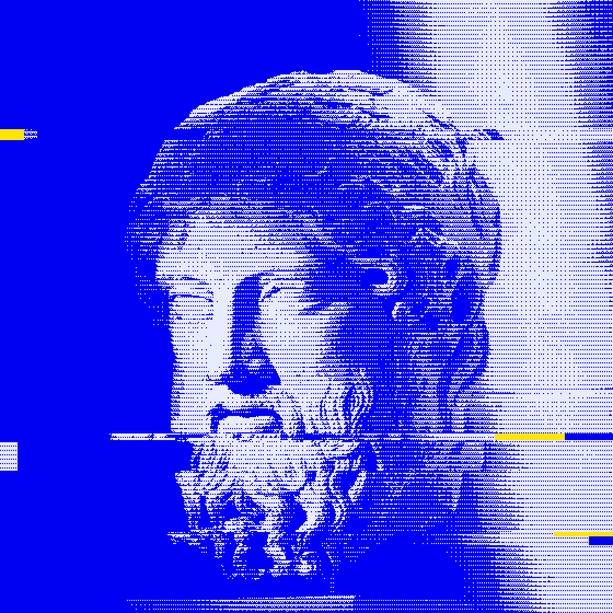
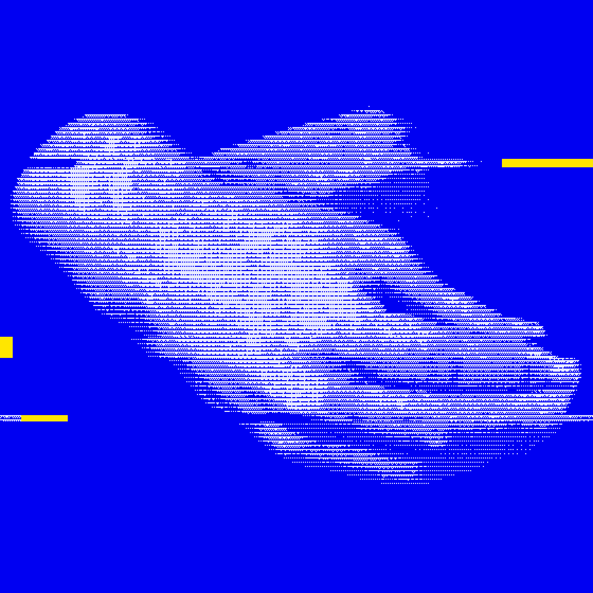

# Design system

The look has a name: glitched marble. It borrows the electric blue
and the condensed type of the Hermes site, and screens classical art
into that blue. The mark, the yellow and the two plates are this
project's own.

This page is the reference and the test page. On the site, every
token and component below is drawn live from the stylesheet, so a
change that breaks one shows here first. On GitHub it reads as plain
tables.

hermes-hands is a community plugin. Nothing here uses the Hermes wing
or any Nous Research mark, and no page may call itself official.

## Brand

The mark is a lowercase h, cut across the legs. The stem and the arch
stay put. The feet land to the right. The brain stays on the host;
the hands work somewhere else.

<!-- hands:marks -->

| File | Ground | Use |
| --- | --- | --- |
|  | any | Favicon, avatar, anywhere the ground is unknown |
|  | light | One colour, on light pages and in print |
|  | blue | One colour, on blue and dark grounds |
|  | blue | The name alone, with the yellow hyphen |
|  | light | The name alone, one colour |
|  | blue | Mark and name together; the masthead uses this |
|  | light | Mark and name together, on light pages |

<!-- /hands:marks -->

Rules for the mark:

- Never smaller than 16 pixels.
- Keep clear space around it equal to the width of one foot.
- The yellow is only for the feet and the hyphen. In one colour, they
  take the same colour as the rest.
- Do not redraw, tilt, outline or recolour it.

The letters are outlines of Geist Mono Medium, so the files need no
font installed.

### Plates

Two public-domain photos from The Metropolitan Museum of Art, screened
into blue by `brand/make-plates.sh`. Plate I is a Roman marble head
from a herm, a pillar that once marked a boundary and carried the
head of Hermes. Plate II is a Roman marble right hand.

| Plate I, the brain | Plate II, the hands |
| --- | --- |
|  |  |

## Colour

Every text pair below passes WCAG AA. The lowest is the red chip, at
5.5 to 1.

<!-- hands:swatches -->

| Token | Light | Dark | Used for |
| --- | --- | --- | --- |
| `--color-ground` | `#f2f2f2` | `#05053d` | The page |
| `--color-ground-raised` | `#e4e5f6` | `#0c0c58` | Callouts, the status box, inline code |
| `--color-text` | `#06066b` | `#f2f2f2` | Body text. 15.1 to 1 on light, 17.1 on dark |
| `--color-text-muted` | `#3a3a9c` | `#aab2ff` | Captions and small notes. 8.3 and 9.6 to 1 |
| `--color-link` | `#0000f2` | `#aab2ff` | Links and focus rings. 8.2 and 9.6 to 1 |
| `--color-line` | `#c9c9dc` | `#2a2a86` | Rules and table lines |
| `--color-field` | `#0000f2` | `#0000f2` | The masthead, the hero, the footer, the diagram |
| `--color-field-deep` | `#0000c2` | `#0000c2` | Boxes on the blue field |
| `--color-field-text` | `#f2f2f2` | `#f2f2f2` | Text on the blue field. 8.2 to 1 |
| `--color-field-muted` | `#c9ceff` | `#c9ceff` | Quiet text on the blue field. 6.0 to 1 |
| `--color-code` | `#00003a` | `#00003a` | Code blocks |
| `--color-code-text` | `#f2f2f2` | `#f2f2f2` | Code. 17.7 to 1 |
| `--color-code-muted` | `#aab2ff` | `#aab2ff` | Code block labels |
| `--color-pass` | `#0000c2` | `#c9ceff` | The "Pass" chip |
| `--color-pass-text` | `#f2f2f2` | `#06066b` | Text on the "Pass" chip |
| `--color-signal` | `#ffe600` | `#ffe600` | Anything not yet proven; the mark's feet |
| `--color-signal-text` | `#06066b` | `#06066b` | Text on yellow. 13.3 to 1 |
| `--color-stop` | `#ff5a4d` | `#ff5a4d` | Hard limits |
| `--color-stop-text` | `#06066b` | `#06066b` | Text on red. 5.5 to 1 |

<!-- /hands:swatches -->

The blue field is the same in both themes. The dark theme changes the
page around it from paper to navy.

## Type

<!-- hands:specimen -->

| Class | Sample |
| --- | --- |
| `type-display` | One agent, two machines |
| `type-title` | How a tool call travels |
| `type-heading` | When a target is down |
| `type-label` | Install · Use · Limits · Tested |
| `type-body` | A session picks its target once, from the folder it was opened in. |
| `type-small` | The output of each run is saved with the rig. |
| `type-mono` | hermes config set terminal.backend hands |
| `type-plate` | Plate II. Marble right hand and wrist. |

<!-- /hands:specimen -->

| Token | Face | Cost |
| --- | --- | --- |
| `--font-display` | Oswald, weights 200 to 700 | 28 KB, self-hosted |
| `--font-mono` | Geist Mono, weight 400 | 10 KB, self-hosted |
| `--font-body` | The system's sans | Nothing |
| `--font-plate` | The system's serif, in italic | Nothing |

Both self-hosted faces are under the SIL Open Font License. Their
license texts sit beside them in `site/static/fonts/`.

| Token | Value |
| --- | --- |
| `--size-label` | 0.75rem |
| `--size-small` | 0.875rem |
| `--size-body` | 1.0625rem |
| `--size-heading` | 1.5rem |
| `--size-title` | 2rem to 3rem, with the window |
| `--size-display` | 2.5rem to 4.75rem, with the window |
| `--track` | 0.1em, for capitals |

## Space

<!-- hands:scale -->

| Token | Value |
| --- | --- |
| `--space-1` | 0.25rem |
| `--space-2` | 0.5rem |
| `--space-3` | 1rem |
| `--space-4` | 1.5rem |
| `--space-5` | 2.5rem |
| `--space-6` | 4rem |

<!-- /hands:scale -->

The gutter is `--gutter`, 1rem, on every screen. Text keeps to
`--measure`, 42rem. The page column is `--column`, 70rem. The
masthead is `--top-height`, 3.5rem, tall.

## Radius

Boxes are square. Only controls are eased, and only a little.

| Token | Value | Used for |
| --- | --- | --- |
| `--radius-box` | 0 | Every box, chip and plate |
| `--radius-control` | 0.125rem | Buttons and focus rings |

## Motion

Motion is small and quick, and it stops for readers who ask their
system for less of it.

| Token | Value | Used for |
| --- | --- | --- |
| `--motion-fast` | 120ms | Hover and press |
| `--motion-slow` | 320ms | Larger moves |
| `--motion-ease` | cubic-bezier(0.2, 0, 0, 1) | Every move |

<!-- hands:motion /-->

## Components

The masthead and the footer are on this page. The hero is on the
[front page](../README.md).

### Status box

A paragraph that opens with a bold "Status:" is boxed.

**Status: an example.** This is how the status line of the README
looks on the site.

### Chips

<!-- hands:chips -->

- Pass
- Not run
- Not tested
- Limit
- v0.1.0

<!-- /hands:chips -->

In a table, a cell that says only "Pass" or "Not run" becomes a chip.

### Table

| Phase | What | Result |
| --- | --- | --- |
| 1 | Routing, file tools, approvals | Pass |
| 5 | A person at the real clients | Not run |

### Code block

Shell and YAML blocks get a Copy button when the script is running.

```bash
hermes hands status
```

```yaml
terminal:
  backend: hands
```

### Callouts

<!-- hands:notice -->

A profile loads plugins only from its own `plugins/` folder.

<!-- /hands:notice -->

<!-- hands:notice {"kind": "untested"} -->

The desktop plugin inside the real Hermes Desktop app.

<!-- /hands:notice -->

<!-- hands:notice {"kind": "limit"} -->

No sandbox. An SSH target can do anything its user can.

<!-- /hands:notice -->

### Diagram

<!-- hands:diagram {
  "caption": "Chat goes to the host. Tool calls come back past the gate."
} -->

```text
  the machine you sit at                    the always-on host
  ----------------------                    ------------------
  Hermes CLI, TUI, Desktop  --- chat --->   Hermes agent loop
  or an editor                              memory, skills, model
                                                   |
                                            approval gate (stock)
                                                   |
                                            hands backend (this plugin)
                                                   |
  your shell and files  <--- SSH, as you ----------+
```

<!-- /hands:diagram -->

## Writing pages

Every page is a Markdown file that must read plainly on GitHub. The
site's extras go in comment blocks, which GitHub hides. See
[site/README.md](../site/README.md) for the blocks and how to build.

## Marketplace assets

The Hermes plugin catalog takes these from the repo, at the commit
the catalog entry pins.

| Asset | File | The catalog's rule |
| --- | --- | --- |
| `image` | `docs/brand/banner.png` | 2 to 1, here 1200 by 600. The listing lays the title over its left side |
| `screenshots` | none yet | Up to six. They wait for a person at the real clients |
| README | `README.md` | Shown as Markdown. Raw HTML is dropped, so it uses none |
